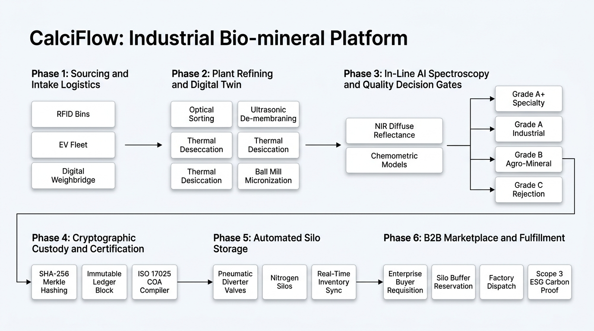

# CalciFlow — End-to-End Implementation Flowchart & Execution Lifecycle

This document provides presentation-ready implementation flowcharts and operational workflow specifications for CalciFlow. It maps the end-to-end technical execution across 6 sequential operational phases: from urban bio-waste intake through digital twin plant refining, in-line AI spectroscopy qualification, cryptographic ledger stamping, and enterprise marketplace fulfillment.

---

## Slide Content: System Implementation Flowchart

### Interactive Mermaid Flowchart Representation

```mermaid
flowchart TD
    %% Global Styling
    classDef intake fill:#f1f5f9,stroke:#64748b,stroke-width:2px,color:#0f172a;
    classDef plant fill:#eff6ff,stroke:#2563eb,stroke-width:2px,color:#0f172a;
    classDef ai fill:#ecfdf5,stroke:#059669,stroke-width:2px,color:#0f172a;
    classDef decision fill:#fef3c7,stroke:#d97706,stroke-width:2px,color:#0f172a;
    classDef ledger fill:#faf5ff,stroke:#7c3aed,stroke-width:2px,color:#0f172a;
    classDef market fill:#f0fdf4,stroke:#16a34a,stroke-width:2px,color:#0f172a;
    classDef reject fill:#fef2f2,stroke:#dc2626,stroke-width:2px,color:#0f172a;

    subgraph PHASE1["PHASE 1: BIO-WASTE SOURCING & REVERSE LOGISTICS"]
        A1["128+ Sourcing Partners<br/>(Restaurants, Hotels, Bakeries, Hatcheries)"]:::intake
        A2["Smart Intake Bins<br/>(UHF RFID Tagged, Hermetically Sealed)"]:::intake
        A3["Electric Logistics Fleet Dispatch<br/>(PostGIS Dynamic Route Optimization)"]:::intake
        A4["Weighbridge Intake Logging<br/>(BLE Digital Tare Weight & Batch ID Assigned)"]:::intake
        
        A1 --> A2 --> A3 --> A4
    end

    subgraph PHASE2["PHASE 2: PLANT REFINING & DIGITAL TWIN AUTOMATION"]
        B1["Mechanical Optical Sorting<br/>(Contaminant Ejection & Foreign Matter Removal)"]:::plant
        B2["Ultrasonic Cavitation De-Membraning<br/>(Acoustic Water Bath Shell-Membrane Separation)"]:::plant
        B3["Thermal Convective Desiccation<br/>(105°C Controlled Loop, Moisture Target < 1.5%)"]:::plant
        B4["High-Energy Ball Mill Micronization<br/>(Ceramic Media Pulverization to Sub-45/75 µm)"]:::plant
        B5["IoT Sensor Mesh & SCADA Bridge<br/>(18 Telemetry Points: Temp, Vibration, Flow)"]:::plant

        A4 --> B1 --> B2 --> B3 --> B4
        B5 -. Telemetry Stream .-> B3
        B5 -. Telemetry Stream .-> B4
    end

    subgraph PHASE3["PHASE 3: IN-LINE AI SPECTROSCOPY & QUALITY GATES"]
        C1["In-Line NIR Spectrometer<br/>(Diffuse Reflectance 900-1700 nm at Mill Chute)"]:::ai
        C2["PyTorch / ONNX Inference Engine<br/>(PLS-DA Chemometric Multi-Spectral Assay)"]:::ai
        C3{"Decision Gate 1<br/>Purity >= 96.0%<br/>D50 < 45 µm<br/>Moisture <= 1.2%"}:::decision
        C4{"Decision Gate 2<br/>Purity >= 93.0%<br/>D50 < 75 µm<br/>Moisture <= 2.0%"}:::decision
        C5{"Decision Gate 3<br/>Purity >= 88.0%<br/>D50 75-120 µm<br/>Moisture <= 3.0%"}:::decision
        
        R1["Grade C Rejected / Downgraded<br/>(Re-routed to Organic Soil Composting)"]:::reject
        G_APLUS["GRADE A+ CERTIFIED<br/>(Micronized Specialty Calcite-X)"]:::ai
        G_A["GRADE A CERTIFIED<br/>(Ultra-Pure Industrial CaCO3)"]:::ai
        G_B["GRADE B CERTIFIED<br/>(Agro-Mineral / Precast CaCO3)"]:::ai

        B4 --> C1 --> C2 --> C3
        C3 -- YES --> G_APLUS
        C3 -- NO --> C4
        C4 -- YES --> G_A
        C4 -- NO --> C5
        C5 -- YES --> G_B
        C5 -- NO --> R1
    end

    subgraph PHASE4["PHASE 4: CRYPTOGRAPHIC CUSTODY & CERTIFICATION"]
        D1["Cryptographic Data Hashing<br/>(Intake + Machine Telemetry + NIR Spectra)"]:::ledger
        D2["Hyperledger Fabric Ledger Seal<br/>(Immutable SHA-256 Merkle Root Transaction)"]:::ledger
        D3["Automated Digital COA Compiler<br/>(ISO 17025 Compliance Certificate & QR Link)"]:::ledger
        D4["Decentralized Archival<br/>(IPFS / Private MinIO PDF & Spectra Storage)"]:::ledger

        G_APLUS --> D1
        G_A --> D1
        G_B --> D1
        D1 --> D2 --> D3 --> D4
    end

    subgraph PHASE5["PHASE 5: AUTOMATED STORAGE & INVENTORY BUFFER"]
        E1["Pneumatic Diverter Routing<br/>(Motorized Gate Valves to Sealed Silos)"]:::plant
        E2["Silo 1: Grade A+ Buffer<br/>(Nitrogen Purged, Ultra-Fine Calcite)"]:::plant
        E3["Silo 2: Grade A Buffer<br/>(Controlled Atmosphere, Masterbatch Calcite)"]:::plant
        E4["Silo 3: Grade B Buffer<br/>(Dry Bulk Silo, Agro-Mineral Calcite)"]:::plant
        E5["Redis Sentinel Real-Time Sync<br/>(Live Kg Inventory Updates to Cloud Backend)"]:::plant

        D4 --> E1
        E1 --> E2 & E3 & E4
        E2 & E3 & E4 --> E5
    end

    subgraph PHASE6["PHASE 6: B2B PROCUREMENT & REVERSE COMMERCE"]
        F1["Industrial Buyer Order Placement<br/>(Polymers, Paper, Paints, Construction)"]:::market
        F2["Automated Stock Reservation & Escrow<br/>(Instant Deduct from Active Silo Inventory)"]:::market
        F3["Automated Dispatch & Bill of Lading<br/>(Verified Digital COA Attached to Packing Slip)"]:::market
        F4["Logistics Delivery & ESG Proof<br/>(78.4% Scope 3 Carbon Offset Certificate Issued)"]:::market

        E5 --> F1 --> F2 --> F3 --> F4
    end
```

---

## Detailed Step-by-Step Implementation Breakdown for Slide Presentation

### Stage 1: Bio-Waste Sourcing & Intake Logistics
1. **Partner Integration:** Registered food service facilities (hotels, commercial bakeries, hatcheries) receive RFID-tagged bio-intake bins.
2. **Logistics Dispatch:** Electric logistics fleet is routed using PostGIS geospatial engines to cluster pickups and minimize transport fuel emissions.
3. **Intake Weigh-In:** Incoming bins are weighed using Bluetooth-connected digital scales; batch records are instantiated in PostgreSQL with origin, gross weight, and timestamp metadata.

### Stage 2: Plant Refining & Digital Twin Automation
1. **Contaminant Ejection:** Raw shells pass through optical vibration sieves to separate plastics, paper, and non-calcium foreign particles.
2. **Cavitation De-Membraning:** High-frequency ultrasonic bath breaks proteinaceous membranes from inner shell walls without chemical solvent contamination.
3. **Thermal Desiccation:** Convective dryer maintains 105.4°C controlled air circulation, monitored continuously by RTD Pt100 temperature transmitters.
4. **Micronization:** Industrial ceramic ball mills grind desiccated flakes down to sub-45 µm and sub-75 µm particle sizes.
5. **Closed-Loop Telemetry:** SCADA system streams 18 machine metrics into TimescaleDB to detect thermal spikes or bearing vibration anomalies before tolerances drift.

### Stage 3: In-Line AI Spectroscopy & Quality Decision Gates
1. **Continuous Spectral Capture:** Diffuse reflectance near-infrared (NIR) sensors scan falling powder streams across the 900–1700 nm band at the mill output chute.
2. **Neural Chemometric Inference:** In-line ONNX runtime processes multivariate regression models in < 1.5 seconds, returning purity %, moisture %, median particle D50, and whiteness index.
3. **Multi-Tier Decision Logic:**
   - **Grade A+ (Specialty Micronized):** Purity >= 96.0%, D50 < 45 µm, Moisture <= 1.2%, Score >= 95. Routed to high-end engineering polymers, medical-grade rubber, and specialty coatings.
   - **Grade A (Ultra-Pure Industrial):** Purity >= 93.0%, D50 < 75 µm, Moisture <= 2.0%, Score >= 90. Routed to masterbatch compounding, PVC extrusion, and paper alkaline sizing.
   - **Grade B (Agro-Mineral / Precast):** Purity >= 88.0%, D50 75–120 µm, Moisture <= 3.0%, Score >= 75. Routed to soil de-acidification, fertilizer carrier, and green precast concrete.
   - **Grade C (Rejected / Downgraded):** Batches failing industrial threshold (< 88.0% purity or excess organic residue) are automatically diverted to bulk agricultural composting.

### Stage 4: Cryptographic Custody & Certification
1. **Merkle Tree Hashing:** Sourcing origin, machine process logs, and spectroscopic test data are hashed into a deterministic SHA-256 Merkle root.
2. **Ledger Commit:** Cryptographic block is sealed onto a permissioned Hyperledger Fabric ledger, establishing tamper-proof chain of custody.
3. **COA Generation:** Automated certificate compiler outputs official ISO 17025-structured Certificate of Analysis PDFs embedding cryptographic verification QR codes.
4. **Decentralized Storage:** Raw spectral curves and signed PDF certificates are archived to IPFS and private MinIO object storage.

### Stage 5: Automated Silo Storage & Inventory Synchronization
1. **Pneumatic Gate Diverters:** Solenoid diverter valves automatically steer validated mineral powder into dedicated nitrogen-purged silos (Silo 1: Grade A+, Silo 2: Grade A, Silo 3: Grade B).
2. **Real-Time Cache Sync:** Active silo load cell data updates Redis Sentinel clusters to broadcast live kilogram availability to the marketplace engine with zero database lag.

### Stage 6: B2B Marketplace Procurement & Circular Settlement
1. **Buyer Requisition:** Industrial procurement managers browse available stock by grade, particle size specification, and price per kg.
2. **Instant Reservation:** Order matching service reserves stock from the active silo buffer and locks transaction escrow.
3. **Fulfillment & Dispatch:** Packing slip is issued with verified digital COA link, and logistics delivery is routed directly to the buyer's factory gate.
4. **ESG Certificate Issuance:** Automated carbon accounting engine calculates avoided limestone calcination (0.18 kg CO2e vs 1.18 kg CO2e) and generates certified Scope 3 GHG reduction proofs.

---

## Slide Presentation Highlights (Speaker Notes / Talking Points)

* **Autonomous In-Line Inspection:** Replaces conventional 48-hour laboratory wet chemistry with sub-1.5-second automated optical NIR grading.
* **Deterministic Quality Guarantees:** Multi-tier decision gates ensure no out-of-spec mineral ever reaches high-performance polymer compounding lines.
* **Complete Physical-to-Digital Sync:** From IoT sensor telemetry to cryptographic blockchain attestation, every kilogram of bio-calcite is fully traceable back to its urban sourcing point.
* **Zero-Waste Value Optimization:** High-grade fractions command premium market prices (₹58/kg for Grade A+), while lower-grade fractions enrich regional soil health, achieving 100% circular utilization.
