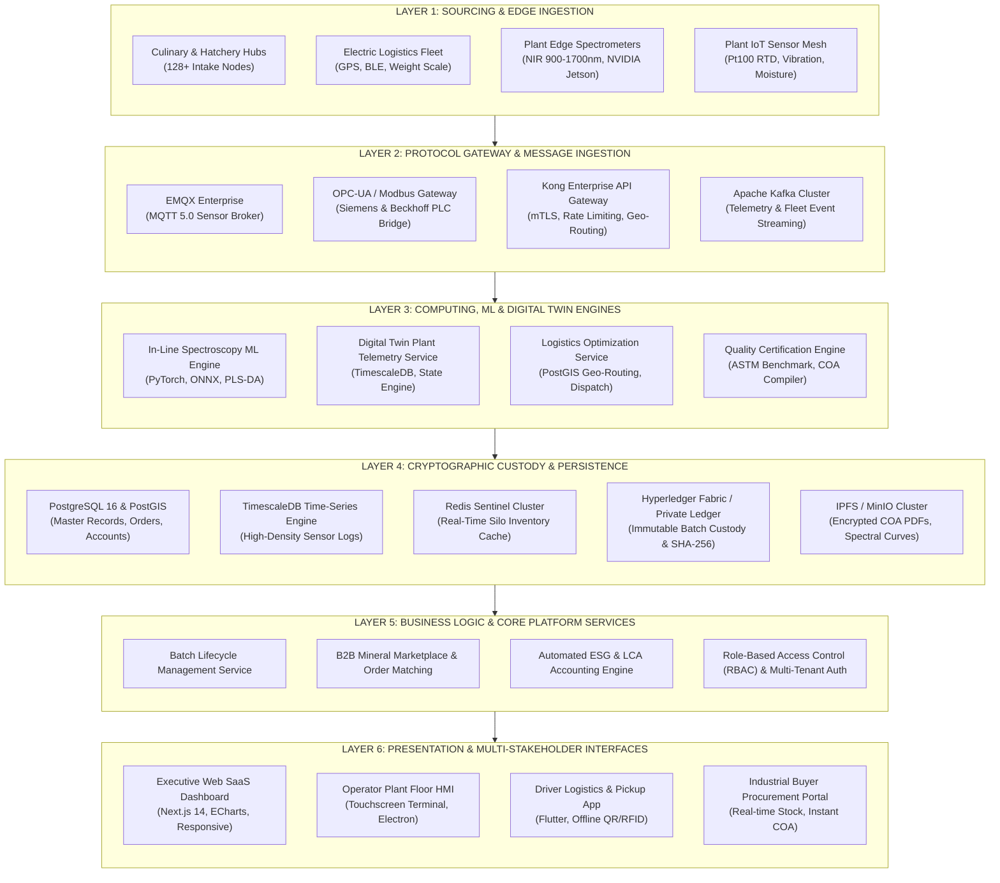
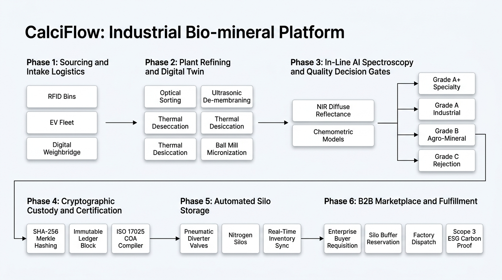
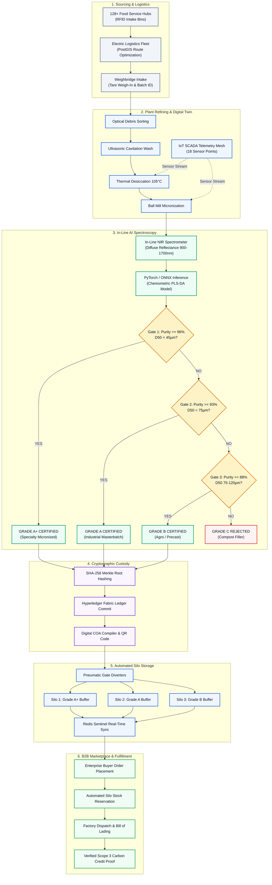

# CalciFlow — Production Tech Stack & System Architecture

This document provides presentation-ready slides and reference documentation for CalciFlow. It details the enterprise-grade technology stack planned for commercial deployment, followed by the complete multi-layer system architecture and data-flow specifications.

---

## SLIDE 1: Enterprise Production Technology Stack
**Slide Title:** CalciFlow Commercial Deployment Architecture & Tech Stack  
**Subtitle:** Resilient, scalable, and audit-compliant bio-mineral refining infrastructure

---

### 1. Edge Ingestion & Industrial Hardware Tier
* **NIR Spectroscopy Hardware:** Specim FX17 Hyperspectral Cameras / Ocean Insight Flame-NIR Spectrometers (900 nm – 1700 nm spectral window)
* **Industrial Edge Compute:** NVIDIA Jetson AGX Orin / Raspberry Pi Compute Module 4 (CM4) Industrial Gateway with hardware watchdog
* **Sensors & Field Bus:** Industrial RTD Pt100 temperature sensors, capacitive moisture probes, piezoresistive triaxial vibration transmitters
* **Logistics & Scale Telemetry:** UHF RFID tags (EPC Gen2), Bluetooth Low Energy (BLE 5.2) digital weight indicators, OBD-II / CAN-bus GPS trackers on electric collection vehicles

---

### 2. Message Streaming & Industrial Ingestion Gateway
* **Industrial Protocols:** OPC-UA (IEC 62541) and Modbus TCP for plant PLC/SCADA integration
* **IoT Message Broker:** EMQX Enterprise (MQTT 5.0 cluster capable of 100M+ concurrent sensor connections)
* **Event Streaming & Buffering:** Apache Kafka with Schema Registry for zero-data-loss streaming of sensor telemetry and vehicle telematics
* **API Gateway:** Kong Enterprise / Apache APISIX for rate-limiting, mTLS authentication, and routing

---

### 3. AI / Machine Learning & Chemometrics Engine
* **Deep Learning & Inference:** PyTorch 2.x for neural feature extraction; ONNX Runtime for sub-50ms edge model acceleration
* **Chemometric Modelling:** Scikit-learn & Chemometrics libraries (Partial Least Squares Discriminant Analysis - PLS-DA, Savitzky-Golay spectral filtering, Multiplicative Scatter Correction)
* **Optical Inspection & Whiteness:** OpenCV for CIE L*a*b* color space calibration, macro-particle sizing, and surface defect classification
* **Distributed Task Orchestration:** Ray Core & Celery with Redis for parallelized batch processing and multi-spectral curve evaluation
* **Model Governance & MLOps:** MLflow for model tracking, artifact versioning, automated drift detection, and shadow testing

---

### 4. Digital Twin & Telemetry Processing
* **Time-Series Database:** TimescaleDB (PostgreSQL engine) / InfluxDB Enterprise for ultra-high-density telemetry ingest (10,000+ points/sec)
* **Digital Twin Framework:** Eclipse Ditto / AWS IoT TwinMaker for state synchronisation between physical machines and digital replicas
* **Closed-Loop Automation Bridge:** Node-RED runtime coupled with programmable logic controllers (Siemens S7-1200 / Beckhoff TwinCAT 3)

---

### 5. Cryptographic Custody & Traceability Ledger
* **Enterprise Distributed Ledger:** Hyperledger Fabric 2.5 (permissioned blockchain with Raft consensus) / Polygon Enterprise Rollup
* **Tokenized Asset Standard:** ERC-1155 / Custom smart contracts for batch serialization, grading provenance, and ownership transfer
* **Cryptographic Attestation:** SHA-256 Merkle root hashing with asymmetric PKI digital signatures for tamper-proof Certificates of Analysis (COA)
* **Decentralized Document Storage:** InterPlanetary File System (IPFS) / Private MinIO cluster for immutable PDF certificate and raw spectral curve archival

---

### 6. Core Backend Services & Data Persistence
* **Microservices Architecture:** Go (Golang) for high-concurrency ingestion engines; NestJS (TypeScript) for domain-driven business APIs
* **Relational Database:** PostgreSQL 16 Enterprise with multi-region read replicas
* **Geospatial Processing:** PostGIS extension for routing optimization, dynamic geofencing, and pickup dispatch logistics
* **In-Memory Caching & State:** Redis Enterprise Cluster for real-time nitrogen silo inventory and active session management
* **Data Lakehouse:** MinIO Object Storage + Apache Parquet for historical spectral analysis and long-term ESG auditing

---

### 7. Presentation & Industrial Client Applications
* **Executive Web Portal:** Next.js 14 (React, TypeScript, App Router, Server Components)
* **Design System & Styling:** Vanilla CSS / Modern Component Tokens with high-contrast accessibility (WCAG 2.1 AA)
* **Telemetry Data Visualisation:** Apache ECharts for high-density time-series graphs; Three.js / WebGL for 3D digital plant twin rendering
* **Driver & Supplier Mobile App:** Flutter / React Native cross-platform app supporting offline-first SQLite cache, hardware camera QR/barcode scanner, and background GPS tracking
* **Plant Floor HMI:** Electron / Webview-based progressive web application (PWA) running on industrial touch panels

---

### 8. Cloud Infrastructure, DevOps & Compliance
* **Container Orchestration:** Kubernetes (K8s via AWS EKS / Azure AKS) with auto-scaling node groups
* **Infrastructure as Code (IaC):** Terraform & Helm Charts for multi-environment deployments
* **Observability & APM:** Prometheus, Grafana, and OpenTelemetry for distributed trace logging
* **Secrets & Zero-Trust Security:** HashiCorp Vault, AWS KMS, Cloudflare Enterprise DDoS & WAF
* **Compliance Engines:** Automated audit logging meeting ISO 9001 (Quality), ISO 14040/44 (Life Cycle Assessment), and ISO 17025 (Testing and Calibration Laboratories) standards

---

## SLIDE 2: End-to-End System Architecture
**Slide Title:** CalciFlow Multi-Layered Industrial Architecture  
**Subtitle:** From distributed urban bio-waste to cryptographically certified mineral supply



---

## SLIDE 3: Architectural Layer Breakdown

### Layer 1: Edge & Sourcing Layer
* Captures raw eggshell inputs at commercial food service points with digital weight verification.
* Ingests high-frequency sensor readings (temperature, chamber pressure, moisture %, spindle vibration) directly from plant processing lines.
* Captures continuous near-infrared diffuse reflectance spectra at the grinding mill discharge chute.

### Layer 2: Protocol Gateway & Ingestion Layer
* Ingests high-throughput sensor packets through dedicated MQTT topics with Quality of Service (QoS 1).
* Decouples stream processing using Apache Kafka topics: `raw-intake`, `plant-telemetry`, `nir-spectra`, `orders`.
* Secures external traffic with API Gateway authentication, mTLS encryption, and automated IP whitelisting.

### Layer 3: Computing, AI & Digital Twin Engine
* Evaluates NIR spectral arrays against calibrated multivariate regression models in less than 1.5 seconds.
* Predicts composite quality score (0–100), CaCO3 purity %, particle median (D50), and moisture content.
* Emits control signals to the digital twin plant model to alert operators if desiccation temperatures deviate from the 105°C setpoint.

### Layer 4: Cryptographic Custody & Persistence Layer
* Records relational domain entities (users, facilities, contracts, orders) in PostgreSQL.
* Stores high-velocity telemetry in TimescaleDB hyper-tables with automated data retention policies.
* Seals batch parameters, operator signatures, and quality scores onto Hyperledger Fabric with an immutable SHA-256 Merkle root.
* Archives cryptographic Certificates of Analysis (COA) to IPFS/MinIO with deterministic content addressing.

### Layer 5: Enterprise Application & Business Services
* Orchestrates order fulfillment, deducting reserved stock from active silos (Grade A+, Grade A, or Grade B).
* Computes lifecycle GHG savings against limestone baseline data using ISO 14040/44 algorithms.
* Manages role-based views for Administrators, Plant Operators, Quality Analysts, Logistics Drivers, and Enterprise Buyers.

### Layer 6: Presentation & Multi-Stakeholder UI Tier
* Responsive, high-density web application built with modern architecture.
* Real-time WebSocket connection to telemetry streams for zero-refresh plant monitoring.
* Native mobile interface for vehicle drivers to scan bin RFID tags, confirm tare weights, and sync route waypoints.

---

## SLIDE 4: Operational Data Flow

```
[ Kitchen Waste Intake ]
        |
        v (RFID Tagged + BLE Scale)
[ Collection Logistics ] ---> Geo-routed by PostGIS engine
        |
        v
[ Refinery Intake Inspection ] ---> Batch CF-2026-XXX created in PostgreSQL
        |
        v (Ultrasonic De-membraning & 105°C Convective Desiccation)
[ Plant Sensor Mesh ] ---> Ingested via OPC-UA / MQTT into TimescaleDB
        |
        v (Sub-45 µm Micronization)
[ In-Line NIR Spectrometer ] ---> Raw array streamed to PyTorch/ONNX inference engine
        |
        v
[ Automated Grade Classification ]
        |---> Grade A+ (Purity >= 96.0%, D50 < 45 µm) -> Specialty Polymers/Rubber Silo
        |---> Grade A  (Purity >= 93.0%, D50 < 75 µm) -> Masterbatch/Paper Silo
        |---> Grade B  (Purity >= 88.0%, 75-120 µm)   -> Eco-Precast/Agro Silo
        |
        v
[ Cryptographic Ledger Stamping ] ---> SHA-256 Hash + Immutable Fabric Block
        |
        v
[ B2B Mineral Marketplace ] ---> Instant Allocation, Digital COA Download, Logistics Dispatch
```

---

## SLIDE 5: Key Architectural Highlights for Presentation

* **Sub-Second Assay Latency:** Inline near-infrared spectroscopy evaluates mineral purity and particle size in < 1.5 seconds, replacing 48-hour conventional laboratory turnarounds.
* **Tamper-Proof Audit Trail:** End-to-end cryptographic custody ensures industrial polymer and medical compounders receive verifiable origin and purity documentation.
* **Closed-Loop Digital Twin:** 18 continuous telemetry points across thermal desiccation and acoustic milling maintain zero-overheating tolerances and 99.8% plant uptime.
* **Elastic Microservices Scalability:** Decoupled Kafka streaming and Kubernetes orchestration allow the system to scale from a single municipal pilot plant to nationwide multi-facility refinery networks.
* **Standardized Industrial Compliance:** Pre-configured data schemas aligned with ISO 9001 quality management, ISO 17025 laboratory calibration, and ISO 14040/44 carbon accounting.

---

## SLIDE 6: End-to-End Implementation Flowchart & Decision Gates
**Slide Title:** Operational Execution Flow & Automated Quality Gates  
**Subtitle:** Closed-loop bio-mineral refining from raw intake to cryptographic dispatch




